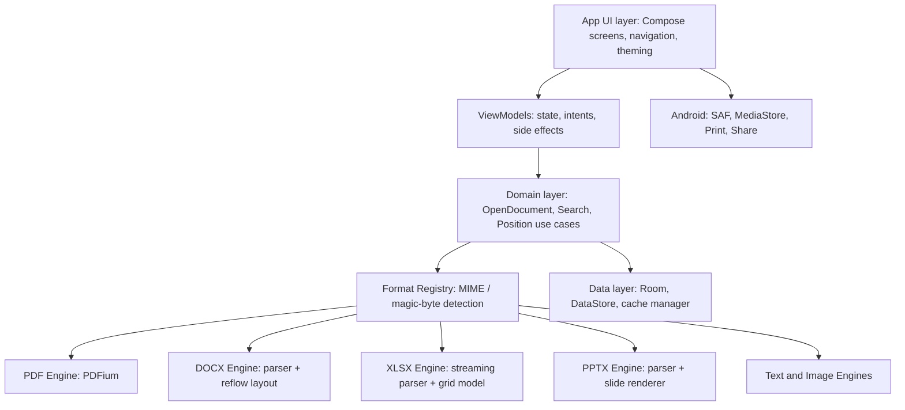

# TID: PocketDoc – Technical Implementation Document

**Document type:** Technical Implementation Document (TID) **Companion to:** PRD: PocketDoc – Offline Mobile Document Viewer for Android **Version:** 1.0 (Draft) **Date:** 2 November 2026 **Audience:** Android engineers, QA, release owner

---

## 1. Purpose and Scope

This document describes how to build PocketDoc v1 as a single, installable Android APK. It covers architecture, technology choices, rendering pipelines per file type, performance design, security, build and signing, testing, and a delivery plan. Requirement IDs (F-, V-, P-, W-, X-, S-) refer to the PRD.

## 2. Key Technical Decisions

| # | Decision | Choice | Rationale |
| --- | --- | --- | --- |
| D1 | Language and UI | Kotlin + Jetpack Compose (Material 3) | Modern, concise, good for custom canvases and gestures |
| D2 | App architecture | Single-activity, MVVM + unidirectional data flow, multi-module Gradle | Fast builds, clear boundaries between engines |
| D3 | PDF engine | PDFium (BSD-3/Apache 2.0) through a native wrapper | Sharp vector rendering, text extraction, search, permissive license |
| D4 | Office engine (v1) | Own renderers built on open-source parsers (XmlPullParser, fastexcel-reader with Aalto XML, Commons CSV); module map in section 16 | Small APK, full control over mobile-first layout, no heavy dependencies |
| D5 | Office engine (v1.5) | Optional high-fidelity engine for legacy formats as a separate module/APK | Keeps v1 small |
| D6 | Offline guarantee | No INTERNET permission in manifest | Verifiable privacy claim |
| D7 | File access | Storage Access Framework + MediaStore, no broad storage permission | Compatible with scoped storage |
| D8 | Persistence | Room (SQLite) for recents, favorites, positions; DataStore for settings | Standard, reliable |
| D9 | Min / target SDK | minSdk 26, targetSdk 35 (raise to the current Play requirement at release time) | Covers about 97% of active devices |
| D10 | Concurrency | Kotlin coroutines and Flow, dedicated dispatchers for render and parse | Cancelable work as the user scrolls |

### 2.1 Why not just use Apache POI or a full office suite?

- **Apache POI** depends on AWT classes that Android does not provide; it also adds tens of MB and slow cold parsing. It is not a good fit for a lightweight mobile viewer.
- **LibreOffice-based engines** (such as LibreOfficeKit) give high fidelity but add roughly 80–150 MB, start slowly, and are designed around desktop page layouts. They are better treated as an optional add-on (D5), not the core.
- **Custom OOXML parsers** (.docx, .xlsx, .pptx are ZIP files of XML) let us read only what a viewer needs, stream large files, and render directly with Compose Canvas into a mobile-friendly layout.

### 2.2 PDF library choice and licensing

| Option | License | Notes |
| --- | --- | --- |
| **PDFium wrapper** (recommended) | BSD-3 / Apache 2.0 | Fast and accurate; compile PDFium for arm64-v8a, armeabi-v7a, x86\_64; must manage native builds or use a maintained prebuilt |
| Android `PdfRenderer` (platform) | Platform | Zero size cost but limited: no text search/selection on older versions, no password prompt flow on all versions |
| `androidx.pdf` (Jetpack) | Apache 2.0 | Still evolving; can be evaluated as a fallback or for specific features |
| MuPDF | AGPL / commercial | Excellent quality but AGPL obligations make it unsuitable unless the app is open source under AGPL or a commercial license is bought |

Recommendation: PDFium for the core viewer. Complete a license review for every dependency before release.

## 3. High-Level Architecture



### 3.1 Gradle Module Layout

| Module | Responsibility |
| --- | --- |
| `:app` | Application class, manifest, navigation, DI wiring |
| `:core:ui` | Theme, shared Compose components, gestures (zoom/pan), tile canvas |
| `:core:common` | Utilities, result types, dispatchers, logging (local only) |
| `:core:data` | Room database, DataStore, cache manager, file metadata |
| `:core:format` | File type detection and the `DocumentEngine` interface |
| `:engine:pdf` | PDFium JNI wrapper (PdfiumAndroid-style) and PdfBox-Android for metadata; page rendering, text and search |
| `:engine:docx` | OOXML Word parser (XmlPullParser, java.util.zip), document model, reflow layout engine |
| `:engine:xlsx` | Spreadsheet parser (fastexcel-reader with Aalto XML, or XmlPullParser; Commons CSV for CSV), cell/style model, grid renderer |
| `:engine:pptx` | Presentation parser (XmlPullParser, java.util.zip), slide model, slide renderer |
| `:engine:text` | Plain text, Markdown, CSV, JSON viewers and image decoding (Android ICU CharsetDetector, commonmark-java, Coil, Telephoto, AndroidSVG) |
| `:feature:home` | Home, recents, favorites, browse |
| `:feature:viewer` | Viewer host screens and shared viewer chrome |
| `:feature:settings` | Settings and about / licenses |

### 3.2 The Engine Contract

Every format implements the same interface so the viewer shell stays generic:

```kotlin
interface DocumentEngine {
    suspend fun open(source: DocumentSource, password: String? = null): DocumentSession
    val capabilities: Set<Capability> // SEARCH, TOC, THUMBNAILS, REFLOW, SELECT_TEXT...
}

interface DocumentSession : AutoCloseable {
    val info: DocumentInfo                  // title, page/slide/sheet count
    suspend fun renderTile(request: TileRequest): Bitmap   // for page-based formats
    fun contentFlow(): Flow<ContentBlock>   // for reflow formats
    suspend fun search(query: String): List<SearchHit>
    suspend fun outline(): List<OutlineItem>
}
```

## 4. File Handling Pipeline

1. **Entry points:** system picker (`ACTION_OPEN_DOCUMENT`), `ACTION_VIEW`, `ACTION_SEND`, and the app's own recents list.
2. **Persist access:** call `takePersistableUriPermission` where possible so recents still open later.
3. **Detect type:** use MIME type first, then file extension, then magic bytes (`%PDF`, ZIP `PK` signature and inner `[Content_Types].xml` to distinguish docx, xlsx, pptx).
4. **Stream, do not copy where avoidable:** open a `ParcelFileDescriptor` for PDFium; for ZIP-based formats use a seekable stream. When random access is impossible, copy once into the app's private cache and clean it on close.
5. **Validate:** enforce limits (file size, uncompressed ZIP size ratio, XML depth, entity expansion off) before parsing.
6. **Open session** through the matching engine and hand it to the viewer.

### 4.1 Manifest Essentials

- No `INTERNET`, `ACCESS_NETWORK_STATE`, or broad storage permissions.
- Intent filters for `application/pdf`, `application/vnd.openxmlformats-officedocument.*`, `text/plain`, `text/csv`, and `image/*`, for both `VIEW` and `SEND`.
- `android:allowBackup="false"` and `dataExtractionRules` that exclude cache and database.
- `android:largeHeap` not used; memory is managed explicitly.

## 5. Rendering Pipelines by Format

### 5.1 PDF (P-1 to P-7, V-1 to V-4)

**Display quality approach**

- Render each page as **tiles** (for example 512 × 512 px) at the current zoom × device density. Vector text stays sharp at every zoom.
- While the user is pinching, scale the existing bitmap for a smooth gesture. When the gesture settles (debounce about 120 ms), render new tiles at the exact scale and cross-fade.
- Use anti-aliasing and LCD-optimized text settings for text; render images with high-quality resampling.
- Support wide-color displays by using `ARGB_8888` (and `RGBA_F16` where HDR is supported) only when needed to save memory.

**Memory and caching**

- Bitmap pool plus an `LruCache` sized to roughly 1/8 of the app's memory class.
- Keep tiles only for visible pages ± 1; keep a low-resolution thumbnail for all pages.
- Cancel off-screen render jobs immediately when scroll direction changes.

**Mobile features**

- **Auto-crop margins:** sample the rendered thumbnail to find the content bounding box per page, then compute the fit-to-width scale using the cropped width.
- **Night mode:** apply a `ColorMatrix` inversion with hue rotation (so photos are not turned into negatives) or render a second pass; allow per-document toggle.
- **Mobile Reading Mode:** extract text with PDFium's text API, rebuild paragraphs with a line-merging heuristic (join lines whose gap is below a threshold, de-hyphenate), then show them in the same reflow view used for Word. Mark clearly as "best effort"; offer fall-back to the original view for scanned or complex PDFs.
- **Search:** PDFium text-find per page in a background coroutine; stream hits into the UI, highlight with quad rectangles from character boxes.

### 5.2 Word .docx (W-1 to W-5)

**Parsing**

- Read `word/document.xml`, `styles.xml`, `numbering.xml`, `footnotes.xml`, `relationships`, and media using `XmlPullParser` in streaming mode.
- Build a **content model**: paragraphs (runs with style), headings, lists (with numbering), tables, images, hyperlinks, page breaks, headers/footers.
- Resolve style inheritance (document defaults → style → direct formatting) once, cache the result.

**Mobile (reflow) layout, default**

- Render the content model in a lazy Compose list. Paragraph text uses `AnnotatedString` with spans for bold, italic, color, and size.
- Tables: render as horizontally scrollable grids; if a table has two to three columns and short content, stack responsively.
- Images: scale to screen width, tap to zoom.
- Fonts: map common Office fonts to bundled, metric-compatible alternatives (for example Calibri → Carlito, Times New Roman → Liberation Serif/Tinos, Arial → Liberation Sans/Arimo). Bundle a compact Noto subset for Indic, Arabic, and CJK scripts, loaded on demand.

**Page view (optional layout)**

- Use Android's `StaticLayout` to paginate to the document's page size and margins, render each page to a canvas, and display with the same tile viewer as PDF. Accept that pagination will differ slightly from desktop Word.

### 5.3 Excel .xls / .xlsx / .csv (X-1 to X-8)

**Current viewer support:** `.xls` and `.csv` open in a basic, read-only scrollable grid. `.xls` workbooks show their sheets and formatted cell values. `.xlsx` and `.tsv` are not yet supported. To limit memory use, `.xls` files are capped at 20 MB, 10,000 rows per sheet, 50 sheets, and 100,000 cells per workbook; `.csv` files are capped at 5 MB, 10,000 rows, and 100,000 cells.

**Parsing**

- For legacy `.xls`, use the Android-compatible Apache POI HSSF reader (`HSSFWorkbook`) and `DataFormatter` to read sheet names and display cell values.
- Open the ZIP, read `workbook.xml`, `sharedStrings.xml`, `styles.xml`, and each `sheetN.xml` lazily in streaming mode (SAX-style) so a 10 MB file does not load everything into memory.
- For `.xlsx`, store cells in a compact structure: sparse row arrays plus an interned string table. Use cached values (`<v>`); do not run a formula engine in v1.
- Parse number formats (built-in IDs and custom format codes) into a formatter for dates, currency, percentages, and scientific notation.

**Grid rendering**

- Custom Compose `Canvas` that draws only the visible cell range. Column widths and row heights come from the sheet; defaults are used otherwise.
- Draw fills, borders, merged cells, wrap-text, and alignment; support RTL.
- Frozen headers drawn in a separate layer that stays pinned while the body scrolls.
- Fling and two-axis scroll via `Modifier.scrollable` with custom state; pinch to zoom scales cell size and font together.
- **Card view:** for the current row, show a vertical list of header → value pairs, with swipe up/down for next/previous row.
- **Cell detail:** tap shows a bottom sheet with full text, raw value, and format.

**CSV/TSV**

- Auto-detect delimiter and encoding (UTF-8, UTF-16, Windows-1252); stream into the same grid model.

### 5.4 PowerPoint .ppt / .pptx (S-1 to S-6)

**Current viewer support:** legacy `.ppt` files open in a slide-by-slide text reader using Apache POI HSLF; titles and text are extracted, but original slide styling and images are not rendered. Files are limited to 20 MB, 500 slides, 20,000 shapes, and 2 MB of extracted text. `.pptx` rendering is not yet supported.

**Parsing**

- For legacy `.ppt`, use Apache POI's HSLF parser from `poi-scratchpad` and read each slide's text shapes.
- Read `presentation.xml` for slide order and size, then each `slideN.xml` along with its layout and master for placeholder inheritance and theme colors and fonts.

**Rendering**

- Create a slide renderer on Android `Canvas`: backgrounds (solid, gradient, image), text boxes with auto-fit, pictures, basic shapes (rectangle, rounded rectangle, ellipse, lines, arrows), tables, and group transforms.
- Render each slide to a bitmap at the display size and cache it; zoom in re-renders just the visible region, like PDF tiles.
- **Outline view:** list slide titles and body text as a reflowable view for quick reading on a small screen.
- Unsupported elements (SmartArt, 3D, embedded media, animations) show a placeholder or the fallback image the file itself often includes; never crash.

### 5.5 Text, Markdown, and Images

- Text: virtualized line list with soft wrap, optional monospace and line numbers; encoding auto-detect.
- Markdown: parse with a small CommonMark library (permissive license) and render with Compose.
- Images: `BitmapRegionDecoder` for large images with subsampling and tile-based zoom; EXIF orientation honored; SVG via a lightweight, sandboxed renderer.

## 6. UI Implementation Notes

- **Viewer shell:** a Compose scaffold with auto-hiding top bar, bottom action bar (search, view mode, theme, more), and a scrubber. Tap to toggle chrome.
- **Gesture layer:** a shared `ZoomableState` handling pinch, double-tap, pan with fling, overscroll, and rotation preservation. The same component is used by PDF, Page view, slides, and images.
- **Theming:** Material 3 with dynamic color; reader themes (light, dark, sepia, true black) applied both to chrome and to rendered content.
- **Edge-to-edge** layouts with proper insets for display cutouts and gesture navigation.
- **State restoration:** `rememberSaveable` plus persisted reading position (page/scroll offset, zoom, view mode) keyed by file URI hash.

## 7. Data Model

| Table | Key fields |
| --- | --- |
| `recent_file` | `id`, `uri`, `display_name`, `mime`, `size`, `last_opened_at`, `thumbnail_path`, `is_favorite` |
| `reading_position` | `file_id`, `page_or_offset`, `zoom`, `view_mode`, `updated_at` |
| `search_history` | `id`, `query`, `created_at` (optional, can be disabled) |

Settings (DataStore): theme, default PDF scroll mode, page-turn gesture, keep-screen-on, font family and size for reflow views, and cache limit.

## 8. Performance Engineering

| Area | Technique |
| --- | --- |
| Cold start | Lazy dependency injection, baseline profile and startup profile, no work on the main thread, defer engine loading until a file opens |
| Rendering | Tile pipeline on a bounded thread pool, cancellable jobs, bitmap reuse, hardware layer for pinch gestures |
| Memory | Streaming parsers, interned strings, sparse cells, downscaled images in Office files, strict pools, low-memory callbacks (`onTrimMemory`) |
| Large files | Progressive open: show first page or rows as soon as ready, continue indexing and search in the background |
| Battery | No background services, no network, no wake locks except the opt-in keep-screen-on |
| APK size | R8 full mode, resource shrinking, ABI splits, WebP assets, strip unused PDFium features, compress fonts, load script-specific fonts on demand |

Tooling: Macrobenchmark and Baseline Profile generator, Android Studio Profiler, LeakCanary in debug builds, and StrictMode in debug builds.

## 9. Security and Privacy

- **No network:** enforced by the absence of the INTERNET permission, and checked by a CI test that fails the build if it is added.
- **Untrusted input:** treat every document as hostile. Limits: maximum file size (for example 500 MB for PDF, 100 MB for Office), maximum uncompressed-to-compressed ZIP ratio (for example 100:1), maximum XML nesting depth, XXE and external entity resolution disabled, per-file parse timeout.
- **Process isolation:** run PDFium and heavy parsers in an isolated process (`android:isolatedProcess` service) in a later hardening step; at minimum catch native crashes at the boundary and show a friendly error instead of killing the whole app.
- **Links:** external links are opened only after a confirmation dialog; `javascript:` and `file:` schemes are blocked. PDF JavaScript is disabled.
- **Scripts and macros:** never executed.
- **Storage:** cache lives in the app's private directory; clear on demand and automatically on a size cap. Password-protected document passwords are held in memory only.
- **Supply chain:** pin dependency versions, verify checksums, generate an SBOM, and review licenses before each release.

## 10. Build, Signing, and Producing the APK

### 10.1 Toolchain

- Android Studio (current stable), Android Gradle Plugin (current stable), Kotlin (current stable), JDK 17+.
- NDK and CMake for the PDFium wrapper; build PDFium once per ABI and publish the `.so` files as a versioned internal artifact to keep CI fast.

### 10.2 Build Variants

| Variant | Purpose |
| --- | --- |
| `debug` | Developer builds with StrictMode, LeakCanary, and debug logging |
| `release` | R8-optimized, signed, no debug tooling |
| `benchmark` | Release-like build with profileable flag for performance tests |

### 10.3 Producing and Signing

```bash
# Release APKs (one per ABI) and a universal APK
./gradlew assembleRelease

# Create a signing key once and store it safely (never commit it)
keytool -genkeypair -v -keystore pocketdoc-release.jks \
  -alias pocketdoc -keyalg RSA -keysize 4096 -validity 10000

# Verify the signature of a built APK
apksigner verify --verbose app-release.apk
```

- Configure `signingConfigs` through environment variables or a local `keystore.properties` file excluded from version control.
- Enable APK signature scheme v2/v3. Back up the keystore in at least two secure locations; losing it prevents updates.
- For Play Store, build an Android App Bundle (`./gradlew bundleRelease`); for direct download, distribute the universal APK or ABI-specific APKs with a clear naming convention (for example `pocketdoc-1.0.0-arm64-v8a.apk`).

### 10.4 CI/CD

- GitHub Actions (or equivalent): lint, unit tests, instrumented tests on a managed device matrix, size check, license check, and artifact upload.
- Fail the build if APK size exceeds the budget by more than 5% or if the manifest gains any network permission.

## 11. Testing Strategy

| Layer | Approach |
| --- | --- |
| Unit | Parsers (styles, number formats, ZIP safety), layout logic, search, file type detection |
| Golden / screenshot | Render a fixed corpus of documents and compare against approved images (Paparazzi or Roborazzi for UI; custom diffs for engines) |
| Corpus testing | At least 500 real-world files: PDFs (scanned, forms, CJK, RTL, large), DOCX (tables, images, lists), XLSX (large, merged cells, custom formats), PPTX (templates, charts, images) |
| Fuzzing | Fuzz the ZIP and XML parsers and the PDFium boundary to catch crashes and hangs |
| Performance | Macrobenchmarks for start-up, open time, scroll jank; memory tests on low-RAM devices |
| Device matrix | Android 8, 10, 12, 14, and current; 3 GB, 4 GB, and 8 GB RAM; small phone, large phone, foldable, tablet; low-end GPU |
| Accessibility | TalkBack walkthroughs, font scale 200%, color-contrast checks |
| Security | Dependency scan, malformed-file suite, manifest checks |
| Manual exploratory | Airplane mode usage, interrupted file transfers, file provider edge cases (WhatsApp, Gmail, Drive offline cache) |

**Release gate:** all P0 requirements verified, corpus open-rate targets met, no known crash in the top 20 scenarios, and performance targets met on the three reference devices.

## 12. Delivery Plan

| Milestone | Weeks | Deliverables |
| --- | --- | --- |
| **M0 Foundation** | 1–2 | Project setup, modules, CI, theme, file picker, intent handling, Room/DataStore, engine interface |
| **M1 PDF** | 3–6 | PDFium integration, tile renderer, zoom/pan, search, thumbnails, password, night mode, recents with thumbnails |
| **M2 Text, images, CSV/XLSX** | 7–10 | Text and Markdown reader, image viewer, streaming XLSX parser, grid renderer, number formats, frozen panes, card view |
| **M3 DOCX and PPTX** | 11–15 | DOCX parser and reflow reader, font mapping, tables and images; PPTX parser, slide renderer, outline view |
| **M4 Hardening** | 16–18 | Performance tuning, baseline profiles, accessibility, fuzzing, corpus fixes, size optimization |
| **M5 Release** | 19 | Signing, final QA, release notes, APK publishing |

A team of two to three Android engineers plus one part-time QA can deliver this in about 19 weeks. A solo developer should expect roughly 30–40 weeks and should consider launching with PDF, text, images, and CSV/XLSX first.

### 12.1 Suggested Minimal Viable Slice (fastest path to a usable APK)

1. File picker and "Open with" for PDF.
2. PDFium tile viewer with pinch zoom, search, dark mode.
3. Recents list.
4. CSV/XLSX basic grid.
5. DOCX reflow reader (text, headings, lists, images).
6. PPTX outline view first, slide rendering second.

## 13. Risks and Technical Mitigations

| Risk | Mitigation |
| --- | --- |
| PDFium native build complexity and ABI coverage | Use a pinned prebuilt or a maintained wrapper; automate builds; keep a fallback to the platform `PdfRenderer` |
| OOXML edge cases (nested tables, odd styles, custom numbering) | Corpus-driven development; graceful degradation to plain text for unsupported blocks |
| Slide fidelity for complex decks | Prefer fallback images where embedded; ship outline view; document unsupported features |
| Memory spikes on huge spreadsheets or images | Streaming, sparse structures, hard limits, subsampled decoding |
| Font licensing for bundled fonts | Use only SIL OFL / Apache-licensed fonts (Noto, Carlito, Liberation, Tinos/Arimo) and include notices in the About screen |
| Native crash in a parser kills the app | Isolated process for risky engines; crash boundary with user-friendly recovery |
| Scope creep into editing | Keep v1 read-only; revisit after launch feedback |

## 14. Definition of Done for v1.0

- [ ] All P0 requirements in the PRD are implemented and verified.
- [ ] Manifest contains no network permission; CI check in place.
- [ ] Open-rate targets met on the 500-file corpus.
- [ ] Cold start, open time, and memory targets met on reference devices.
- [ ] Accessibility checks passed (TalkBack, font scale, contrast).
- [ ] License audit complete; notices included in the app.
- [ ] Release APK signed, verified with `apksigner`, and archived with its mapping file and keystore backup.
- [ ] Release notes and user-facing privacy statement written.

## 15. Appendix

### 15.1 Suggested Libraries (verify current versions and licenses)

This list is a short overview. Section 16 is the authoritative module map; where the two differ, follow section 16.

| Purpose | Candidate |
| --- | --- |
| UI | Jetpack Compose, Material 3, Navigation Compose |
| DI | Hilt or Koin |
| Persistence | Room, DataStore |
| Async | Kotlin Coroutines, Flow |
| Image loading (thumbnails) | Coil |
| Markdown | A CommonMark-compliant library |
| Encoding detection | juniversalchardet or ICU |
| Testing | JUnit, Turbine, Robolectric, Paparazzi/Roborazzi, Macrobenchmark |
| Static analysis | ktlint, detekt, Android Lint |

### 15.2 Minimal Manifest Sketch

```xml
<manifest xmlns:android="http://schemas.android.com/apk/res/android">
    <!-- Intentionally no INTERNET permission -->
    <application
        android:allowBackup="false"
        android:supportsRtl="true"
        android:theme="@style/Theme.PocketDoc">
        <activity android:name=".MainActivity" android:exported="true">
            <intent-filter>
                <action android:name="android.intent.action.MAIN"/>
                <category android:name="android.intent.category.LAUNCHER"/>
            </intent-filter>
            <intent-filter>
                <action android:name="android.intent.action.VIEW"/>
                <category android:name="android.intent.category.DEFAULT"/>
                <data android:mimeType="application/pdf"/>
                <data android:mimeType="application/vnd.openxmlformats-officedocument.wordprocessingml.document"/>
                <data android:mimeType="application/vnd.openxmlformats-officedocument.spreadsheetml.sheet"/>
                <data android:mimeType="application/vnd.openxmlformats-officedocument.presentationml.presentation"/>
                <data android:mimeType="text/plain"/>
            </intent-filter>
        </activity>
    </application>
</manifest>
```

## 16. Open-Source Module Map: Which Module for Which File

This section makes the build plan concrete: for every file type, which open-source component does the work, what license it carries, and what we still write ourselves. It refines decision D4 in section 2. Where the table says "custom", the renderer is our own code, but it is built on the open-source parsers and utilities listed beside it, not written from nothing.

> **Before adopting any library:** check its latest release date, open issues, Android support, and license on its repository. Several Android PDF and Office libraries are lightly maintained or have forks, and versions change often. Pin exact versions and record the decision in the dependency log.

### 16.1 Primary Module per File Type

| File type | Primary open-source module | License | What it does for us | What we write ourselves |
| --- | --- | --- | --- | --- |
| **PDF** (.pdf) | **PDFium** via an Android wrapper (for example `PdfiumAndroid` / `AndroidPdfViewer` by barteksc, or a maintained fork; verify status) | BSD-3 / Apache 2.0 | Page rendering, text extraction, search, links, bookmarks, password-protected files | Tile renderer, zoom/pan, night mode, auto-crop, reading mode, search UI |
| PDF (metadata, fallback text) | **PdfBox-Android** (port of Apache PDFBox) | Apache 2.0 | Metadata, document info, fallback text extraction | Glue code only; avoid for rendering (slow, heavy) |
| PDF (alternative engine) | **androidx.pdf** (Jetpack) and platform `PdfRenderer` | Apache 2.0 / Platform | Backup renderer on devices where the native PDFium build fails | Engine adapter implementing `DocumentEngine` |
| **Word** (.docx) | **Android `XmlPullParser`** + `java.util.zip` (platform), with **Apache Commons Compress** only if a robust ZIP reader is needed | Platform / Apache 2.0 | Streaming read of `document.xml`, `styles.xml`, `numbering.xml`, media | Content model, style resolver, reflow layout in Jetpack Compose, page view |
| **Excel** (.xls) | **Apache POI HSSF Android port** (`HSSFWorkbook`) | Apache 2.0 | Read legacy workbook sheets and formatted cell values | Read-only Compose grid |
| **Excel** (.xlsx) | **fastexcel-reader** (MIT) with the **Aalto XML** StAX implementation (Apache 2.0), or our own SAX-style parser on `XmlPullParser` | MIT / Apache 2.0 | Streaming row and cell reading with low memory use | Style and number-format mapping, grid renderer, frozen panes, card view |
| **CSV** | **Apache Commons CSV** | Apache 2.0 | Robust parsing of quoted and multiline cells | Grid rendering |
| **PowerPoint** (.ppt) | **Apache POI HSLF** (`poi-scratchpad`) | Apache 2.0 | Read legacy presentation slides and text shapes | Read-only slide text viewer |
| **PowerPoint** (.pptx) | **Android `XmlPullParser`** + `java.util.zip` (platform) | Platform | Reading slides, layouts, masters, themes, media | Slide renderer on `Canvas`, outline view, notes, thumbnails |
| **Plain text, logs, JSON, XML** | **Android ICU `CharsetDetector`** (`android.icu.text`, built into the platform since API 24) | Platform | Encoding detection (UTF-8, UTF-16, Windows-1252, and others) | Virtualized text view, line numbers, search |
| **Markdown** (.md) | **commonmark-java** (or JetBrains `markdown`) | BSD-2 / Apache 2.0 | Parsing Markdown to a syntax tree | Compose renderer for headings, lists, code, tables |
| **Images** (.jpg, .png, .webp, .gif) | **Coil** (with `coil-gif`) and **Telephoto** (zoomable and subsampling image components for Compose) | Apache 2.0 | Decoding, caching, and zoom of large images | Gesture integration with the shared viewer shell |
| **SVG** | **AndroidSVG** (via `coil-svg`) | Apache 2.0 | Rendering SVG to a drawable | Sandboxing and size limits |
| **ZIP-protected or encrypted archives** (if needed) | **Zip4j** | Apache 2.0 | Safe reading of encrypted ZIP entries | Password prompt UI |
| **Legacy Office** (.doc, and high-fidelity .xls/.ppt rendering) and **OpenDocument** (.odt, .ods, .odp), v1.5 | **LibreOfficeKit** (from LibreOffice / Collabora's open-source Android work) | MPL 2.0 | High-fidelity conversion and rendering of legacy and ODF formats | Optional separate module or APK to keep v1 small; engine adapter |
| **EPUB** (v2) | **Readium Kotlin Toolkit** | BSD-3 | EPUB parsing, navigation, and rendering | Theming and reader integration |

### 16.2 Application and Infrastructure Modules

| Area | Open-source module | License |
| --- | --- | --- |
| UI | Jetpack Compose, Material 3, Navigation Compose | Apache 2.0 |
| Dependency injection | Hilt (or Koin) | Apache 2.0 |
| Persistence | Room, DataStore | Apache 2.0 |
| Async | Kotlin Coroutines and Flow | Apache 2.0 |
| Thumbnails and image cache | Coil | Apache 2.0 |
| Charts in spreadsheets (v1.5) | Vico or MPAndroidChart | Apache 2.0 |
| Printing and sharing | Android `PrintManager` and `FileProvider` (platform) | Platform |
| Performance profiling | Baseline Profile and Macrobenchmark, LeakCanary | Apache 2.0 |
| Static analysis | ktlint, detekt, Android Lint | MIT / Apache 2.0 |
| Screenshot tests | Paparazzi or Roborazzi | Apache 2.0 |
| Unit tests | JUnit, Turbine, Robolectric | EPL / Apache 2.0 / MIT |
| License reporting | Gradle license plugin (for example the AboutLibraries plugin) | Apache 2.0 |

### 16.3 Fonts (all open licenses)

| Purpose | Font | License |
| --- | --- | --- |
| Replaces Calibri | Carlito | SIL OFL |
| Replaces Times New Roman | Tinos or Liberation Serif | Apache 2.0 / SIL OFL |
| Replaces Arial | Arimo or Liberation Sans | Apache 2.0 / SIL OFL |
| Replaces Courier New | Cousine or Liberation Mono | Apache 2.0 / SIL OFL |
| Multi-script coverage (Devanagari, Arabic, CJK, and others) | Noto family, loaded on demand | SIL OFL |

### 16.4 Libraries to Avoid or Treat with Care

| Library | Reason |
| --- | --- |
| **MuPDF** | AGPL (or paid commercial license); only usable if the whole app is AGPL or a commercial license is purchased |
| **Apache POI** (HWPF, XWPF, XSSF, XSLF) for rendering | Depends on desktop Java classes that Android lacks, very large, slow cold start; acceptable only in a later, optional module for legacy file support |
| **docx4j** | Heavy JAXB-based stack, poor Android fit |
| **iText** | AGPL |
| **Any library that requires the INTERNET permission or bundles analytics or ad SDKs** | Breaks the offline and privacy guarantee |

### 16.5 Integration Pattern

Each row in 16.1 is wrapped behind the same `DocumentEngine` interface from section 3.2. This keeps libraries replaceable.

1. The **Format Registry** detects the file type and selects the engine.
2. The **engine module** (`:engine:pdf`, `:engine:docx`, and so on) owns its open-source dependencies. No other module depends on them directly.
3. A **license check** runs in CI and fails the build if a dependency with a disallowed license (AGPL, GPL without exception, or unknown) is added.
4. An **About / Open-source licenses** screen is generated from the dependency list and shipped in the app.

### 16.6 Suggested Build Order Using These Modules

| Step | Work | Modules involved |
| --- | --- | --- |
| 1 | Project skeleton, file picker, recents | Compose, Room, DataStore, Hilt |
| 2 | PDF viewer | PDFium wrapper, own tile renderer, PdfBox-Android for metadata |
| 3 | Text, Markdown, images | Android ICU CharsetDetector, commonmark-java, Coil, Telephoto |
| 4 | CSV and XLSX | Commons CSV, fastexcel-reader plus Aalto XML (or custom `XmlPullParser`), own grid renderer |
| 5 | DOCX reader | `XmlPullParser`, own content model and Compose reflow view, bundled open fonts |
| 6 | PPTX viewer | `XmlPullParser`, own `Canvas` slide renderer |
| 7 | Hardening and release | Macrobenchmark, Paparazzi, license plugin, R8 |
| 8 (v1.5) | Legacy and ODF support | LibreOfficeKit as an optional module |

### 16.7 Open Items to Verify Before Coding

- Confirm which PDFium wrapper is actively maintained and supports 16 KB page sizes and the latest Android NDK; if none is suitable, build PDFium directly from the upstream project.
- Confirm that `fastexcel-reader` plus Aalto XML runs cleanly on Android and meets the memory target on a 10 MB workbook; otherwise use the custom `XmlPullParser` path.
- Measure the real APK size added by each module and update the size budget in the PRD.
- Complete the license audit for every module in 16.1 and 16.2 and record the result.
